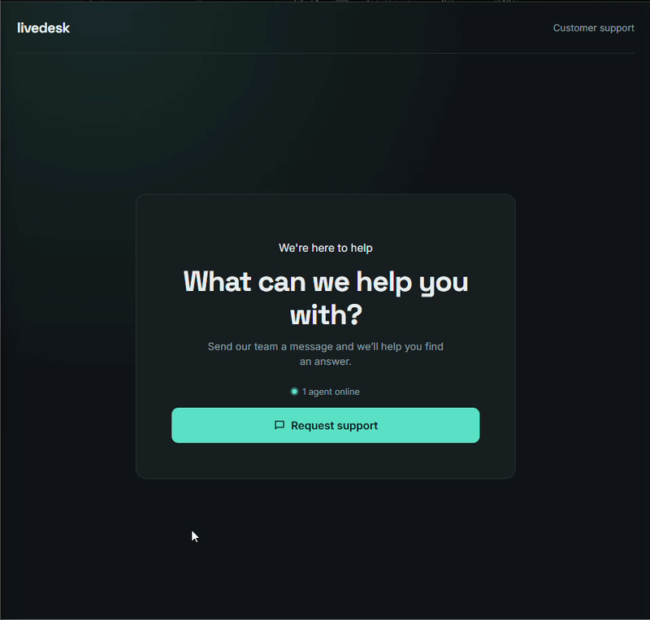
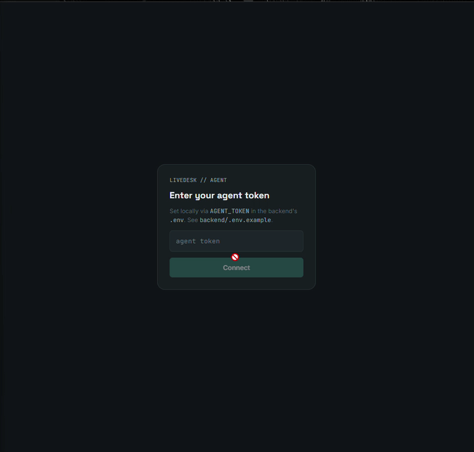
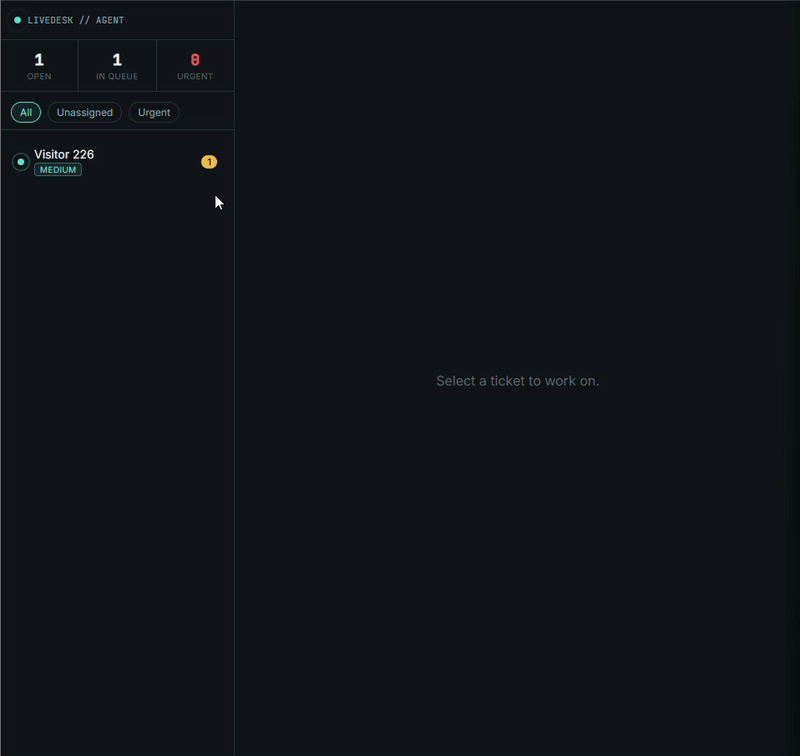

# LiveDesk — Real-Time Customer Support Chat

A real-time customer support chat application built with React and FastAPI. LiveDesk provides a visitor-facing support widget and an agent dashboard, with persistent conversations and messages, live presence and typing indicators, and ticket status, priority, and assignment controls.


---

## Preview

### Visitor support page


### Agent login


### Agent dashboard and conversations


---

## About the project

LiveDesk is a small customer support platform built to demonstrate how persistent data and real-time state can work together:

- **Durable state** — conversations, messages, status, priority, and assignment are stored in a relational database.
- **Live state** — agent presence, visitor presence, and typing indicators are kept in the backend's in-memory connection manager and are not persisted.
- **Real-time updates** — WebSockets deliver messages and activity to the relevant conversation and agent dashboard.

Messages are saved before they are broadcast, so the displayed conversation stays consistent with its history. Each conversation has its own room; agents also join a shared feed to receive new-conversation, presence, and ticket-update events.

## Technology stack

**Frontend**
- React 18
- Vite
- React Router
- Custom CSS with a shared design-token system
- Node.js tests for frontend utilities
- Vercel or Netlify for static hosting

**Backend**
- Python
- FastAPI and native WebSockets
- SQLAlchemy and Alembic
- SQLite for local development; PostgreSQL is supported through `DATABASE_URL`
- Uvicorn
- pytest and FastAPI `TestClient`
- Render deployment configuration included in `render.yaml`

## Features

- Visitor support page with an embedded chat experience
- Agent dashboard with a live conversation list
- Persistent conversation and message history
- Real-time messages, typing indicators, and client/agent presence
- Presence snapshot for agents: a dashboard that connects or reconnects starts from who is online right now, and a visitor with several tabs stays online until the last one closes
- Live online-agent count on the visitor page
- Conversation status (`open`, `in_progress`, or `resolved`)
- A conversation becomes a ticket on the visitor's first message, so visitors who only open the chat never clutter the queue; the list is ordered by latest activity and shows a preview of the last message
- A customer replying on a resolved ticket reopens it for every connected agent; an agent's reply never does
- Conversation priority (`low`, `medium`, `high`, or `urgent`)
- Assignment field and live ticket updates for connected agents
- WebSocket reconnection with exponential backoff
- Conversation-specific client tokens for visitor access
- Agent-only REST endpoints and WebSocket access protected by `AGENT_TOKEN`
- Alembic migrations, including a test that checks migration/model consistency
- Backend tests plus frontend linting, tests, and production build in CI

### Authentication note

Agent access currently uses one shared `AGENT_TOKEN`; there are no individual agent accounts or roles. Agents pick a display name when they sign in, but it is not an identity: two agents who choose the same name count as one online agent. The development default is `dev-only-agent-token` and must not be used in production. When `APP_ENV=production`, the backend refuses to start if the default token is still configured. Visitor access is scoped to a conversation using a `client_token` issued when the conversation is created.

## API

Interactive API documentation is available at `/docs` while the backend is running.

### REST endpoints

| Method | Route | Description | Access |
|--------|-------|-------------|--------|
| GET | `/api/health` | Health check | Public |
| GET | `/api/agents/online-count` | Number of connected agents | Public |
| POST | `/api/conversations` | Creates a conversation and returns its client token | Public |
| GET | `/api/conversations` | Lists tickets (conversations with at least one message), most recent activity first, with a last-message preview | `X-Agent-Token` header |
| GET | `/api/conversations/{conversation_id}/messages` | Returns conversation history | `X-Agent-Token` or matching `X-Client-Token` header |
| PATCH | `/api/conversations/{conversation_id}` | Updates status, priority, or assignment | `X-Agent-Token` header |

### WebSocket endpoints

| Route | Description | Access |
|-------|-------------|--------|
| `/ws/agents?name={name}&token={agent_token}` | Agent feed for conversation activity and presence | Agent token |
| `/ws/conversations/{conversation_id}?role=client&name={name}&token={client_token}` | Visitor chat room | Conversation's client token |
| `/ws/conversations/{conversation_id}?role=agent&name={name}&token={agent_token}` | Agent chat room | Agent token |

The conversation WebSocket supports `message` and `typing` events. Messages are persisted; typing events are transient and broadcast only to connected participants.

## Running the project locally

### Prerequisites

- Python 3.12
- Node.js 20 and npm

### 1. Clone the repository

```bash
git clone https://github.com/marinsnanadev/livedesk.git
cd livedesk
```

### 2. Start the backend

```bash
cd backend
python -m venv .venv
```

Copy the example environment file to `.env`:

```powershell
# Windows PowerShell
Copy-Item .env.example .env
```

```bash
# macOS / Linux
cp .env.example .env
```

Activate the environment:

```powershell
# Windows PowerShell
.\.venv\Scripts\Activate.ps1
```

```bash
# macOS / Linux
source .venv/bin/activate
```

Install dependencies, apply the database migration, and start the API:

```bash
pip install -r requirements.txt
```

```bash
alembic upgrade head
uvicorn app.main:app --reload
```

The backend is available at `http://localhost:8000`. The API documentation is at `http://localhost:8000/docs`.

The local defaults work without changing the example environment values. Set these variables in `backend/.env` when needed:

| Variable | Description | Default |
|----------|-------------|---------|
| `APP_ENV` | Application environment. Set to `production` to enforce a non-default agent token. | `development` |
| `AGENT_TOKEN` | Shared secret for agent REST endpoints and WebSockets. Use a strong, private value outside local development. | `dev-only-agent-token` |
| `DATABASE_URL` | SQLAlchemy database URL. SQLite is used locally; PostgreSQL URLs are supported. | `sqlite:///./livedesk.db` |
| `CORS_ORIGINS` | Comma-separated frontend origins allowed to call the API. | `http://localhost:5173,http://127.0.0.1:5173` |

#### Backend tests

From the `backend` directory, with the virtual environment active:

```bash
pytest -v
```

### 3. Start the frontend

In a second terminal:

```bash
cd frontend
npm install
```

If you need to change the API URL, copy `.env.example` to `.env` in the `frontend` directory:

```powershell
# Windows PowerShell
Copy-Item .env.example .env
```

```bash
# macOS / Linux
cp .env.example .env
```

The default API URL is `http://localhost:8000`. Start Vite:

```bash
npm run dev
```

Open the agent dashboard at `http://localhost:5173/` and sign in with a display name and the backend's `AGENT_TOKEN`. Open the visitor experience at `http://localhost:5173/widget`. Use both routes in separate tabs to try a conversation.

| Variable | Description | Default |
|----------|-------------|---------|
| `VITE_API_BASE` | Base URL for the backend API. WebSocket URLs are derived from this value. | `http://localhost:8000` |

#### Frontend tests and build

From the `frontend` directory:

```bash
npm run lint
npm test
npm run build
```

## Roadmap

- Add individual agent identities and authentication
- Add rate limiting for message sends
- Support closing and reopening conversations from the interface
- Add push notifications when agents are offline

## Author

Developed by **Nana** — Software Engineering student, with prior experience as a full-stack developer.

[GitHub](https://github.com/marinsnanadev) 
[LinkedIn](https://www.linkedin.com/in/gianna-marins-734944234/)